# Modelo de Datos — DriWin

**Motor:** PostgreSQL 16 · **Base de datos:** `driwin_catalog` · **14 tablas** · migraciones hasta la **011**
**Fuente única de verdad:** [`db/init.sql`](./init.sql) (DDL + DML idempotente) y [`db/migrations/`](./migrations/)

> El bloque Mermaid se dibuja automáticamente en GitHub. La versión con estilo para el documento
> técnico es la Figura 2, en [`docs/Hito2/figuras/figura2-modelo-datos.html`](../docs/Hito2/figuras/figura2-modelo-datos.html).

## 1. Diagrama Entidad-Relación

```mermaid
erDiagram
    %% ---------------- Catálogo, perfiles y planes ----------------
    HARDWARE_COMPONENTS ||--o{ DRIVER_PACKAGES : "soporta"
    USER_PROFILES ||--o{ DRIVER_PACKAGES : "define"
    USER_PROFILES ||--o{ PROFILE_APPS : "agrupa"
    RECOMMENDED_APPS ||--o{ PROFILE_APPS : "asigna"
    BLOATWARE_RULES ||--o{ BLOATWARE_PROFILE_POLICY : "se aplica"
    USER_PROFILES ||--o{ BLOATWARE_PROFILE_POLICY : "decide"
    SUBSCRIPTION_TIERS ||--o{ SYNTHETIC_USERS : "financia"
    %% ---------------- Cuentas DriWin (migraciones 008 y 010) ----------------
    ACCOUNTS ||--o{ ACCOUNT_DEVICES : "registra"
    ACCOUNTS ||--o{ ACCOUNT_SESSIONS : "abre"
    ACCOUNTS |o--o{ SUBSCRIPTIONS : "compra"
    SUBSCRIPTION_TIERS ||--o{ SUBSCRIPTIONS : "vende"
    ACCOUNTS ||--o{ SUPPORT_TICKETS : "consulta"

    USER_PROFILES {
        int profile_id PK
        string profile_name UK
        string optimization_focus
        timestamp created_at
    }

    HARDWARE_COMPONENTS {
        int component_id PK
        string ven_id
        string dev_id
        string subsys_id "DEFAULT GENERIC"
        string commercial_name
        string category
        timestamp created_at
    }

    DRIVER_PACKAGES {
        int driver_id PK
        int component_id FK "CASCADE"
        int profile_id FK "RESTRICT"
        string os_environment
        string edition_name
        string version_number
        date release_date
        string download_url "Azure Blob"
        int file_size_mb
        string silent_install_flags "sin uso: el instalador se abre visible"
        boolean is_whql_certified
        string sha256 "CHECK hexadecimal de 64"
        timestamp created_at
    }

    RECOMMENDED_APPS {
        int app_id PK
        string app_name UK
        string category
        string version_number
        string download_url
        int file_size_mb
        string silent_install_flags
        string winget_id "CHECK formato"
        string official_url "CHECK https"
        timestamp created_at
    }

    PROFILE_APPS {
        int profile_id PK, FK
        int app_id PK, FK
        timestamp assigned_at
    }

    BLOATWARE_RULES {
        int bloatware_id PK
        string app_display_name
        string package_signature UK
        string_array package_names "CHECK formato"
        string detection_powershell_cmd
        string removal_powershell_cmd
        string risk_level "BAJO, MEDIO o ALTO"
        string description
        string help_text
        timestamp created_at
    }

    BLOATWARE_PROFILE_POLICY {
        int bloatware_id PK, FK "CASCADE"
        int profile_id PK, FK "CASCADE"
        string policy "SUGERIDO, OPCIONAL o PROTEGIDO"
    }

    SUBSCRIPTION_TIERS {
        int tier_id PK
        string tier_name UK
        string target_persona
        string pricing_model
        numeric price_clp
        int max_devices
        string device_scope
        string description
        int duration_months UK "12, 24 o 36"
        timestamp created_at
    }

    SYNTHETIC_USERS {
        int user_id PK
        string full_name
        string email UK "ficticio"
        string user_role_type
        int tier_id FK "RESTRICT"
        string_array selected_profiles_array "índice GIN"
        int active_devices_count
        timestamp created_at
    }

    ACCOUNTS {
        int account_id PK
        bytea email_lookup UK "HMAC-SHA256"
        bytea email_encrypted "AES-256-GCM"
        string password_hash "scrypt"
        int failed_logins
        timestamptz locked_until
        string privacy_version
        timestamptz privacy_accepted_at
        timestamptz created_at
    }

    ACCOUNT_DEVICES {
        int device_id PK
        int account_id FK "CASCADE"
        bytea device_hash "SHA-256"
        timestamptz registered_at
        timestamptz last_seen_at
    }

    ACCOUNT_SESSIONS {
        int session_id PK
        int account_id FK "CASCADE"
        bytea token_hash UK "SHA-256"
        bytea device_hash
        timestamptz created_at
        timestamptz expires_at
        timestamptz revoked_at
    }

    SUBSCRIPTIONS {
        int subscription_id PK
        int account_id FK "SET NULL"
        int tier_id FK "RESTRICT"
        timestamptz starts_at
        timestamptz ends_at
        numeric price_paid_clp
        string payment_reference UK "SIM- (simulado)"
        timestamptz created_at
    }

    SUPPORT_TICKETS {
        int ticket_id PK
        int account_id FK "CASCADE"
        string subject
        bytea message_encrypted "AES-256-GCM"
        string status "ABIERTA, RESPONDIDA o CERRADA"
        timestamptz created_at
    }
```



## 2. Restricciones relevantes

| Objeto | Tipo | Definición | Mapeo en la API |
|---|---|---|---|
| `uq_hardware_signature` | UNIQUE | `(ven_id, dev_id, subsys_id)` | `23505` → `409 CONFLICT` |
| `uq_driver_recommendation` | UNIQUE | `(component_id, profile_id, os_environment)` | `23505` → `409 CONFLICT` |
| `uq_bloatware_signature` | UNIQUE | `(package_signature)` | `23505` → `409 CONFLICT` |
| `pk_profile_apps` | PK compuesta | `(profile_id, app_id)` | `23505` → `409 CONFLICT` |
| `pk_bloatware_profile_policy` | PK compuesta | `(bloatware_id, profile_id)` | `23505` → `409 CONFLICT` |
| `ux_account_device` | UNIQUE | `(account_id, device_hash)` | El servicio no lo duplica: actualiza `last_seen_at` |
| `chk_driver_sha256` | CHECK | `sha256` nulo o 64 hexadecimales | `23514` → `400 VALIDATION_ERROR` |
| `ck_app_size` | CHECK | `file_size_mb > 0` | `23514` → `400 VALIDATION_ERROR` |
| `chk_app_winget_id` / `chk_app_official_url` | CHECK | formato de id de winget / URL `https://` | `23514` → `400 VALIDATION_ERROR` |
| `ck_bloatware_risk` | CHECK | `risk_level IN ('BAJO','MEDIO','ALTO')` | `23514` → `400 VALIDATION_ERROR` |
| `ck_bloatware_package_names` | CHECK | nombres de paquete con caracteres permitidos | `23514` → `400 VALIDATION_ERROR` |
| `ck_bloatware_policy` | CHECK | `policy IN ('SUGERIDO','OPCIONAL','PROTEGIDO')` | — (lo carga la migración) |
| `ck_tier_price` / `ck_tier_devices` | CHECK | `price_clp ≥ 0` / `max_devices > 0` | `23514` → `400 VALIDATION_ERROR` |
| `ck_tier_duration` | CHECK | `duration_months IN (12, 24, 36)` | — |
| `ck_active_devices` / `ck_profiles_not_empty` | CHECK | `active_devices_count ≥ 0` / al menos un perfil | `23514` → `400 VALIDATION_ERROR` |
| `ck_account_lookup_len` / `ck_device_hash_len` | CHECK | huellas de exactamente 32 bytes | — (las calcula el servidor) |
| `ck_account_failed` | CHECK | `failed_logins ≥ 0` | — |
| `ck_account_privacy` | CHECK | versión y fecha del aviso de privacidad: ambas o ninguna | — (prueba del consentimiento, migración 010) |
| `ck_session_expiry` | CHECK | `expires_at > created_at` | — |
| `ck_subscription_dates` / `ck_subscription_price` | CHECK | `ends_at > starts_at` / `price_paid_clp ≥ 0` | — |
| `ck_ticket_status` | CHECK | `status IN ('ABIERTA','RESPONDIDA','CERRADA')` | — |
| `fk_driver_component` / `fk_driver_profile` | FK | `driver_packages → hardware_components` (CASCADE) / `→ user_profiles` (RESTRICT) | `23503` → `422 FK_VIOLATION` |
| `fk_pa_profile` / `fk_pa_app` | FK | `profile_apps → user_profiles / recommended_apps` | `23503` → `422 FK_VIOLATION` |
| `fk_bpp_rule` / `fk_bpp_profile` | FK | `bloatware_profile_policy → bloatware_rules / user_profiles` (CASCADE) | — |
| `fk_user_tier` | FK | `synthetic_users.tier_id → subscription_tiers` (RESTRICT) | `23503` → `422 FK_VIOLATION` |
| FK de cuentas | FK | equipos, sesiones y consultas → `accounts` (CASCADE); `subscriptions.account_id` (SET NULL) | Al borrar la cuenta, las ventas quedan anónimas |

## 3. Índices

| Índice | Columnas | Para qué |
|---|---|---|
| `uq_hardware_signature` (de la restricción única) | `(ven_id, dev_id, subsys_id)` | Búsqueda del caso de uso por su prefijo `(ven_id, dev_id)`. El antiguo `idx_hardware_lookup` era redundante y se quitó (migración 011, ver [`docs/qa/explain/`](../docs/qa/explain/README.md)) |
| `idx_driver_profile` | `(profile_id)` | Unión por perfil y protección al borrar un perfil (`RESTRICT`) |
| `idx_profile_apps_app` | `(app_id)` | "¿Qué perfiles recomiendan esta app?" |
| `ux_tier_duration` (único) | `(duration_months)` | Un solo plan por duración |
| `idx_synthetic_users_profiles` | GIN `selected_profiles_array` | Filtro por perfil (`TEXT[]`) |
| `idx_sessions_account` | `(account_id)` | Cerrar las sesiones de una cuenta o equipo |
| `idx_subscriptions_account` | `(account_id, ends_at DESC)` | Suscripción vigente sin ordenar |
| `idx_tickets_account` | `(account_id)` | Consultas de una cuenta |

Además, cada `UNIQUE` y cada clave primaria crean su propio índice (por ejemplo, `accounts.email_lookup` para el inicio de sesión y `account_sessions.token_hash` para validar cada petición con cuenta).

## 4. Roles y permisos (migración 007)

| Rol | Inicio de sesión | Permisos |
|---|:---:|---|
| `driwin_owner` | No | Dueño de las tablas. Las migraciones se ejecutan con `SET ROLE driwin_owner` |
| `driwin_api` | Sí (la API) | Lee el catálogo; escribe solo en `hardware_components`, `driver_packages` y `bloatware_rules`; opera las tablas de cuentas. Sin acceso a `synthetic_users` ni al esquema |
| `driwin_backup` | Sí | Solo lectura de todo (respaldos) |
| `driwin_reporting` | Sí | Solo las vistas `v_resumen_planes`, `v_catalogo_por_perfil` y `v_ventas_por_plan` (sin datos personales) |
| `driwin_admin` | Sí | Administrador de Azure: solo personas, nunca la API |

Las contraseñas de los roles se definen con `\password` en psql y no se guardan en el repositorio.

## 5. Tipos PostgreSQL → TypeScript

| PostgreSQL | `pg` devuelve | DTO / Zod |
|---|---|---|
| `SERIAL` / `INT` | `number` | `number` (Zod `coerce.number().int().positive()`) |
| `NUMERIC(12,2)` | `string` | Se convierte con `Number()` si se expone |
| `BOOLEAN` | `boolean` | `boolean` |
| `DATE` | `Date` | Se formatea con `to_char(..., 'YYYY-MM-DD')` → `string` |
| `TIMESTAMP` / `TIMESTAMPTZ` | `Date` | `new Date(...).toISOString()` |
| `TEXT` / `VARCHAR` | `string` | `string` con `min/max` espejo del DDL |
| `TEXT[]` | `string[]` | `string[]` (`array_agg` / `ANY($n::text[])`) |
| `BYTEA` | `Buffer` | Nunca se expone: lo cifra o compara `security/crypto.ts` |

## 6. Verificación de la semilla

```sql
SELECT COUNT(*) AS perfiles      FROM user_profiles;             -- 4
SELECT COUNT(*) AS componentes   FROM hardware_components;       -- 8
SELECT COUNT(*) AS drivers       FROM driver_packages;           -- 23
SELECT COUNT(*) AS apps          FROM recommended_apps;          -- 20 (18 con winget, 2 con página oficial)
SELECT COUNT(*) AS vinculos      FROM profile_apps;              -- 20
SELECT COUNT(*) AS reglas        FROM bloatware_rules;           -- 30 (11 bajo, 9 medio, 10 alto)
SELECT COUNT(*) AS politicas     FROM bloatware_profile_policy;  -- 120
SELECT COUNT(*) AS planes        FROM subscription_tiers;        -- 3 (1, 2 y 3 años)
SELECT COUNT(*) AS usuarios_test FROM synthetic_users;           -- 6
SELECT COUNT(*) AS cuentas       FROM accounts;                  -- 0 (se crean desde la app)
```

Los usuarios de `synthetic_users` son **ficticios** y usan el dominio `@correo-driwin.cl`, en cumplimiento del principio de minimización de la Ley N.º 21.719. Las cuentas reales guardan sus datos personales cifrados (ver la sección 7.2 del documento técnico).
