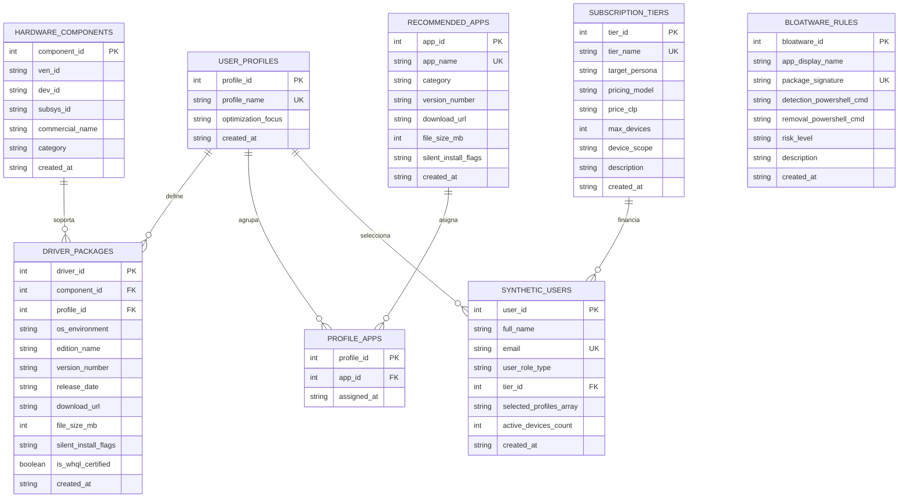

# Modelo de Datos — DriWin (Hito 2)

**Motor:** PostgreSQL 16 · **Base de datos:** `driwin_catalog`
**Fuente única de verdad:** [`db/init.sql`](./init.sql) (DDL + DML idempotente)

> Este documento es el diagrama Entidad-Relación
> El bloque Mermaid se renderiza automáticamente en GitHub;
> para el PDF se puede exportar como PNG/SVG desde cualquier visor Mermaid.

## 1. Diagrama Entidad-Relación



## 2. Restricciones e índices relevantes

| Objeto | Tipo | Definición | Mapeo en la API |
|---|---|---|---|
| `uq_hardware_signature` | UNIQUE | `(ven_id, dev_id, subsys_id)` | `23505` → `409 CONFLICT` |
| `uq_driver_recommendation` | UNIQUE | `(component_id, profile_id, os_environment)` | `23505` → `409 CONFLICT` |
| `uq_bloatware_signature` | UNIQUE | `(package_signature)` | `23505` → `409 CONFLICT` |
| `pk_profile_apps` | PK compuesta | `(profile_id, app_id)` | `23505` → `409 CONFLICT` |
| `ck_app_size` | CHECK | `file_size_mb > 0` | `23514` → `400 VALIDATION_ERROR` |
| `ck_bloatware_risk` | CHECK | `risk_level IN ('BAJO','MEDIO','ALTO')` | `23514` → `400 VALIDATION_ERROR` |
| `ck_tier_price` | CHECK | `price_clp IS NULL OR price_clp >= 0` | `23514` → `400 VALIDATION_ERROR` |
| `ck_tier_devices` | CHECK | `max_devices IS NULL OR max_devices > 0` | `23514` → `400 VALIDATION_ERROR` |
| `ck_active_devices` | CHECK | `active_devices_count >= 0` | `23514` → `400 VALIDATION_ERROR` |
| `ck_profiles_not_empty` | CHECK | `cardinality(selected_profiles_array) >= 1` | `23514` → `400 VALIDATION_ERROR` |
| `fk_driver_component` | FK | `driver_packages.component_id → hardware_components` (`ON DELETE CASCADE`) | `23503` → `422 FK_VIOLATION` |
| `fk_driver_profile` | FK | `driver_packages.profile_id → user_profiles` (`ON DELETE RESTRICT`) | `23503` → `422 FK_VIOLATION` |
| `fk_pa_profile` / `fk_pa_app` | FK | `profile_apps → user_profiles / recommended_apps` | `23503` → `422 FK_VIOLATION` |
| `fk_user_tier` | FK | `synthetic_users.tier_id → subscription_tiers` (`ON DELETE RESTRICT`) | `23503` → `422 FK_VIOLATION` |
| `idx_hardware_lookup` | Índice | `(ven_id, dev_id)` | Búsqueda del caso de uso |
| `idx_driver_profile` | Índice | `(profile_id)` | Unión de perfiles |
| `idx_profile_apps_app` | Índice | `(app_id)` | "¿qué perfiles recomiendan esta app?" |
| `idx_synthetic_users_profiles` | Índice GIN | `selected_profiles_array` | Filtro por perfil (`TEXT[]`) |

## 3. Tipos PostgreSQL → TypeScript

| PostgreSQL | `pg` devuelve | DTO / Zod |
|---|---|---|
| `SERIAL` / `INT` | `number` | `number` (Zod `coerce.number().int().positive()`) |
| `NUMERIC(12,2)` | `string` | Se convierte con `Number()` si se expone |
| `BOOLEAN` | `boolean` | `boolean` |
| `DATE` | `Date` | Se formatea con `to_char(..., 'YYYY-MM-DD')` → `string` |
| `TIMESTAMP` | `Date` | `new Date(...).toISOString()` |
| `TEXT` / `VARCHAR` | `string` | `string` con `min/max` espejo del DDL |
| `TEXT[]` | `string[]` | `string[]` (`array_agg` / `ANY($n::text[])`) |

## 4. Verificación de la semilla

```sql
SELECT COUNT(*) AS perfiles      FROM user_profiles;        -- 4
SELECT COUNT(*) AS componentes   FROM hardware_components;  -- 6
SELECT COUNT(*) AS drivers       FROM driver_packages;      -- 9
SELECT COUNT(*) AS apps          FROM recommended_apps;     -- 20
SELECT COUNT(*) AS vinculos      FROM profile_apps;         -- 20
SELECT COUNT(*) AS reglas        FROM bloatware_rules;      -- 3
SELECT COUNT(*) AS planes        FROM subscription_tiers;   -- 5
SELECT COUNT(*) AS usuarios_test FROM synthetic_users;      -- 6
```

Los usuarios de `synthetic_users` son **ficticios** y usan el dominio
`@correo-driwin.cl`, en cumplimiento del principio de minimización y del
Anexo D (Ley N.º 21.719) de la guía del Hito 2.
