# Mapa de navegación y arquitectura de la información — DriWin

ISO/IEC 25010 · **Usabilidad** (capacidad de aprendizaje, operabilidad, protección frente a errores, accesibilidad).
Referencia: Pérez-Montoro, *Arquitectura de la información en entornos web* (organización, etiquetado, navegación, búsqueda) y checklist del curso: **toda función a 3 clics o menos**.

## 1. Mapa de la app

```mermaid
flowchart TD
  INICIO(["Abrir DriWin<br/>(1.ª vez: cuestionario de perfil)"]) --> DW

  subgraph BARRA["Barra superior — siempre visible (navegación global)"]
    DW["DriWin<br/>(pantalla principal)"]
    AP["Apps"]
    OP["Optimizar Windows"]
    SA["Chequeo de salud 👑"]
    CU["👤 Cuenta"]
    CF["⚙ Configuración"]
    PR["👑 Premium"]
  end

  DW --> DW1["Drivers actuales ↔ Drivers a actualizar<br/>[Instalar] por driver"]
  DW --> DW2["[Instalar todo] 👑 → diálogo → [Instalar N seleccionados]"]
  AP --> AP1["Apps recomendadas por perfil<br/>[Instalar] (winget) / [Página oficial]"]
  OP --> OP1["Bloatware por riesgo (sugeridas ya marcadas)<br/>[Ejecutar limpieza] → [Sí, quitar]"]
  SA --> SA1["Respaldo de drivers<br/>[Elegir carpeta] (opcional) → [Hacer respaldo]"]
  SA --> SA2["Dispositivos desconectados<br/>[Revisar dispositivos] → [Quitar N seleccionados]"]
  PR --> PR1["3 planes → [Elegir] → (sin sesión: Crear cuenta) → [Confirmar pago]"]
  CU --> CU1["Sin sesión: Iniciar sesión / Crear cuenta (+ aviso de privacidad)"]
  CU --> CU2["Mi cuenta: plan · equipos [Quitar] · [Soporte técnico]<br/>[Cerrar sesión] · [Descargar mis datos] · [Borrar mis datos] · Aviso de privacidad"]
  CF --> CF1["General: idioma · tema · aviso de privacidad"]
  CF --> CF2["Perfil: [Volver a hacer el cuestionario]"]
  CF --> CF3["Premium: estado del plan e interruptores"]
  CF --> CF4["Avanzado: origen del escaneo"]
```

**Profundidad máxima: 2 niveles** (pestaña o botón de la barra → panel o diálogo). No hay menús anidados.

## 2. Método de conteo

- **Punto de partida:** la pantalla principal (pestaña DriWin), con el perfil ya elegido.
- **Se cuentan** los clics dentro de DriWin.
- **No se cuentan:** escribir en un campo o marcar casillas de selección (es ingresar datos, no navegar) ni las ventanas de **Windows** que aparecen fuera de DriWin (UAC, "Guardar como", asistente del fabricante).
- **Llegar** = clics hasta la pantalla donde se hace la tarea (la regla de los 3 clics). **Completar** = clics hasta ejecutarla.
- Verificado leyendo el código (`App.tsx` y `components/`) y recorriendo la app (prueba con capturas del 2026-11-10).

## 3. Clics por tarea

| # | Tarea | Ruta | Llegar | Completar | ≤ 3 |
|---|---|---|:---:|:---:|:---:|
| 1 | Ver drivers instalados y recomendados | Pantalla principal | 0 | 0 | ✅ |
| 2 | Instalar un driver | DriWin → **Instalar** | 0 | 1 | ✅ |
| 3 | Instalar todo (Premium) | **Instalar todo** → **Instalar N seleccionados** | 1 | 2 | ✅ |
| 4 | Instalar una app recomendada | **Apps** → **Instalar** | 1 | 2 | ✅ |
| 5 | Quitar el bloatware sugerido | **Optimizar Windows** → **Ejecutar limpieza** → **Sí, quitar** | 1 | 3 | ✅ |
| 6 | Respaldar drivers (Premium) | **Chequeo de salud** → **Hacer respaldo** | 1 | 2 | ✅ |
| 7 | Quitar dispositivos desconectados (Premium) | **Chequeo de salud** → **Revisar dispositivos** → **Quitar N** | 1 | 3 | ✅ |
| 8 | Ver los planes Premium | **Premium** | 1 | 1 | ✅ |
| 9 | Comprar Premium (con sesión) | **Premium** → **Elegir** → **Confirmar** | 2 | 3 | ✅ |
| 10 | Comprar Premium (persona nueva) | **Premium** → **Elegir** → formulario *Crear cuenta* → **Confirmar** | 2 | 4 ¹ | ✅ |
| 11 | Iniciar sesión | **👤** → formulario → **Iniciar sesión** | 1 | 2 | ✅ |
| 12 | Crear una cuenta | **👤** → **Crear cuenta** → formulario → **Crear cuenta** | 2 | 3 | ✅ |
| 13 | Descargar mis datos | **👤** → **Descargar mis datos** | 1 | 2 | ✅ |
| 14 | Borrar mis datos | **👤** → **Borrar mis datos** → contraseña → **Borrar definitivamente** | 2 | 3 | ✅ |
| 15 | Pedir soporte técnico (Premium) | **👤** → **Soporte técnico** → formulario → **Enviar** | 2 | 3 | ✅ |
| 16 | Quitar un equipo de la cuenta | **👤** → **Quitar** → **Confirmar** | 1 | 3 | ✅ |
| 17 | Cerrar sesión | **👤** → **Cerrar sesión** | 1 | 2 | ✅ |
| 18 | Cambiar el idioma o el tema | **⚙** → opción | 1 | 2 | ✅ |
| 19 | Leer el aviso de privacidad | **⚙** → **Leer el aviso** (también desde el registro y desde Mi cuenta) | 2 | 2 | ✅ |
| 20 | Cambiar de perfil | **⚙** → **Perfil** → **Volver a hacer el cuestionario** → elegir → **Confirmar** | 3 | 4 ¹ | ✅ |
| 21 | Ver una ayuda (**?**) | Botón **?** junto a la función | 1 | 1 | ✅ |

**Resultado: 21 de 21 tareas se alcanzan en 3 clics o menos** (máximo: 3, cambiar de perfil). En promedio, llegar a una tarea toma **1,3 clics**.

¹ Las dos únicas tareas que necesitan 4 clics para **completarse** incluyen llenar un formulario (crear la cuenta o elegir perfiles). Para **llegar** a ellas bastan 2 y 3 clics.

### Mejora aplicada durante esta revisión

- **Comprar Premium sin cuenta tomaba 5 clics:** el diálogo se abría en "Iniciar sesión" y había que cambiar a "Crear cuenta". Quien llega desde "Elegir plan" sin sesión casi siempre es una persona nueva (la versión gratis no necesita cuenta), así que ahora el diálogo abre directo en **Crear cuenta** (`initialAuthMode` en `AccountDialog.tsx`). Quedó en 4. Quien ya tiene cuenta sigue teniendo la pestaña "Iniciar sesión" a un clic.

## 4. Arquitectura de la información (Pérez-Montoro)

| Sistema | Cómo lo resuelve DriWin | Evaluación |
|---|---|:---:|
| **Organización** | Por **tarea** de la persona, no por estructura técnica: Drivers · Apps · Optimizar · Salud. El contenido se ordena solo según el **hardware detectado** y el **perfil** elegido (Gamer, Creador, Oficina, Desarrollador). | ✅ |
| **Etiquetado** | Botones con verbo de acción ("Instalar", "Ejecutar limpieza", "Hacer respaldo", "Descargar mis datos"); confirmaciones que dicen exactamente qué pasará ("¿Quitar 3 apps?"); textos en español e inglés con test de paridad; 👑 marca lo Premium y 🔒 lo bloqueado. | ✅ |
| **Navegación** | **Global:** barra superior fija con las 7 entradas, siempre visible, con la pestaña activa resaltada. **Contextual:** botones dentro de cada panel. **Local:** apartados en Configuración. Sin callejones sin salida: todo diálogo se cierra con ✕, Cancelar, Esc o clic afuera; las vistas internas tienen "← Volver". | ✅ |
| **Búsqueda** | No hay buscador, **a propósito**: la app no muestra un catálogo para explorar, sino que **filtra automáticamente** lo que corresponde a tu PC (9 dispositivos en el PC de muestra) y a tu perfil (unas 20 apps). Un buscador agregaría un paso innecesario. | ✅ Justificado |
| **Ayuda contextual** | Botón **?** (HelpTip) en las funciones que lo necesitan (riesgo del bloatware, contraseña, equipos de la cuenta) y `title` con el motivo en los botones deshabilitados. | ✅ |
| **Retroalimentación** | Progreso de descarga e instalación por driver; estados ("Instalando…", "✓ Quitada"); errores con código, `requestId` y **Reintentar**. Si el servidor tarda más de 5 s, se explica que puede estar despertando (hasta ~1 min, arranque en frío medido de 54 s). | ✅ |
| **Protección frente a errores** | Confirmación antes de acciones destructivas (quitar apps, quitar equipos, borrar datos con contraseña); punto de restauración obligatorio antes de quitar bloatware de riesgo ALTO; los instaladores se abren visibles para revisar los términos. | ✅ |

## 5. Mejoras aplicadas en esta revisión

| Hallazgo | Cambio | Archivo |
|---|---|---|
| Comprar Premium sin cuenta: 5 clics | El diálogo abre en "Crear cuenta" cuando se viene de elegir un plan → 4 | `App.tsx`, `AccountDialog.tsx` |
| Arranque en frío de ~54 s mostraba solo "Cargando…": parecía colgada | A los 5 s aparece la explicación (con `aria-live` para lectores de pantalla) | `App.tsx` (`LoadingServer`) |

## 6. Limitaciones

- El conteo se hizo sobre el código y con recorridos propios del equipo, **no con usuarios externos**. Pérez-Montoro recomienda validar con pruebas con usuarios (por ejemplo, pedir a 5 personas que completen las tareas 2, 4, 5 y 10 sin ayuda y medir el tiempo y los errores). Queda propuesto como siguiente paso.
