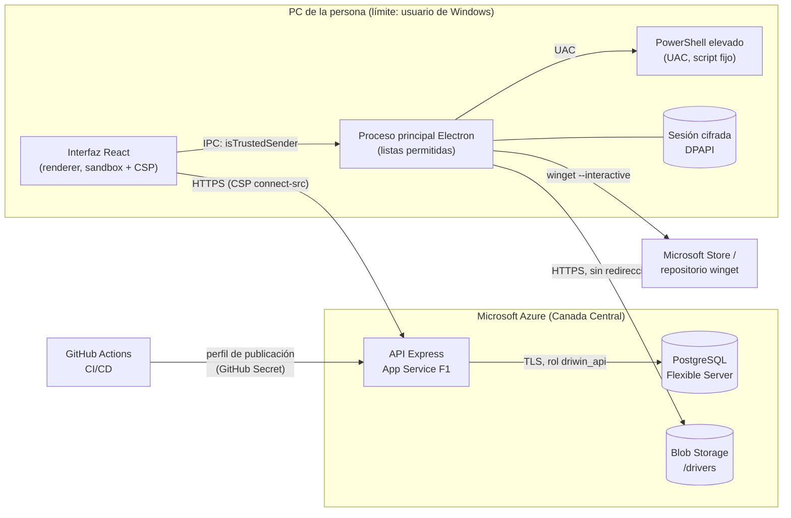

# Modelo de amenazas STRIDE — DriWin

ISO/IEC 25010 · **Seguridad** (confidencialidad, integridad, no repudio, responsabilidad, autenticidad).
Referencia: Tanya Janca, *Alice and Bob Learn Secure Coding* (modelado de amenazas, SCA, secretos, registros).
Versión del sistema: rama `main` al 2026-11-11 (migraciones hasta la 011).

## 1. Qué protegemos (activos)

| Activo | Por qué importa |
|---|---|
| **El PC de la persona** | DriWin descarga instaladores y ejecuta tareas **como administrador** (UAC). Es el activo más crítico: un driver manipulado compromete el equipo completo. |
| **Datos personales de las cuentas** | Correo, compras, consultas de soporte, consentimiento (Ley 19.628 / 21.719). |
| **Integridad del catálogo** | Qué driver o app se recomienda, su URL y su huella SHA-256. |
| **Secretos** | `API_KEY` (escritura del catálogo), `DATA_ENCRYPTION_KEY`, contraseñas de PostgreSQL, perfil de publicación de Azure (GitHub Secrets). |
| **Disponibilidad de la API** | Sin API, la app no recomienda nada. App Service F1 con 60 min de CPU al día. |

## 2. Diagrama de flujo de datos y límites de confianza

Límites de confianza (donde los datos cambian de dueño y hay que validar):
**①** interfaz → proceso principal (IPC), **②** proceso principal → administrador (UAC), **③** app → API (Internet), **④** API → base de datos, **⑤** app → Blob/winget (lo que se descarga), **⑥** GitHub → Azure (despliegue).

## 3. Amenazas y controles

Riesgo residual = probabilidad × impacto **después** de los controles. Estado: ✅ mitigado · ⚠️ aceptado (con justificación) · 🔧 mejora propuesta.

### S — Suplantación (Spoofing)

| ID | Amenaza | Control implementado | Evidencia | Residual | Estado |
|---|---|---|---|:---:|:---:|
| S-01 | Alguien inicia sesión como otra persona (fuerza bruta) | Contraseña ≥ 10 caracteres hasheada con scrypt; bloqueo de 15 min tras 5 intentos; límite de 10 intentos/15 min por IP; mismo mensaje y mismo tiempo si el correo no existe (hash ficticio) | `account.service.ts` (login), `rateLimit.ts`; tests de integración "bloquea la cuenta" y "responde lo mismo" | Bajo | ✅ |
| S-02 | Robo del token de sesión | Token aleatorio `dws_`; en la base solo su SHA-256; vence a los 30 días; se revoca al cerrar sesión o quitar el equipo; en el PC se guarda cifrado con DPAPI (solo ese usuario de Windows lo descifra) | `crypto.ts`, `sessionStore.ts`; test "cerrar sesión invalida el token" | Bajo | ✅ |
| S-03 | Un servidor falso se hace pasar por la API | Solo HTTPS (certificado de Azure); la CSP limita `connect-src` al dominio de la API | `vite.config.ts` (CSP); prueba CDP: otro servidor → bloqueado | Bajo | ✅ |
| S-04 | Uso de la clave de solo lectura que estuvo embebida en el .exe | Clave **revocada** en Azure y eliminada del código; una clave inválida recibe 401 en cualquier ruta | Test "clave revocada → 401"; captura del .exe antiguo rechazado | Muy bajo | ✅ |
| S-05 | Una página web llama a la API desde el navegador de la persona | CORS con lista permitida (`app://driwin`, dev), sin credenciales | `app.ts` (`corsOptions`) | Bajo | ✅ |

### T — Manipulación (Tampering)

| ID | Amenaza | Control implementado | Evidencia | Residual | Estado |
|---|---|---|---|:---:|:---:|
| T-01 | **Instalador de driver manipulado** (el riesgo más grave: se ejecuta con UAC) | 4 capas: (1) solo `https://driwinstorage.blob.core.windows.net/drivers/*.exe`, sin puerto, usuario ni query; (2) redirecciones prohibidas; (3) SHA-256 del catálogo obligatorio; (4) firma Authenticode `Valid` de Windows | `installerPolicy.ts`, `driverInstaller.ts`; tests de política en Electron | Bajo | ✅ |
| T-02 | Firma válida pero de **otro** fabricante (se acepta cualquier firma válida) | Mitigado en parte por T-01 (origen fijo + SHA-256 del catálogo) | — | Bajo | 🔧 Fijar el firmante esperado por driver (Intel, NVIDIA, MediaTek…) |
| T-03 | Alguien con la `API_KEY` cambia el catálogo (URL o SHA-256) | La URL igual debe estar en nuestro contenedor (T-01) y la firma debe ser válida; la clave nunca va en la app, solo en el App Service y en el Postman del administrador; comparación en tiempo constante | `authenticate.ts`, `installerPolicy.ts` | Medio | ⚠️ Una sola clave compartida, sin rotación periódica → ver R-01 |
| T-04 | La interfaz (renderer) comprometida pide acciones peligrosas por IPC | `contextIsolation`, `sandbox`, sin `nodeIntegration`; cada canal IPC verifica el emisor; listas permitidas para paquetes de bloatware, ids de winget, páginas oficiales y clases de dispositivos; el JSON de "Descargar mis datos" se valida (≤ 2 MB) y la ruta la elige la persona | `main.ts`, `appPolicy.ts`, `bloatwarePolicy.ts`, `ghostDevices.ts`, `dataExport.ts`; 77 tests de Electron | Bajo | ✅ |
| T-05 | Inyección de comandos en PowerShell elevado | Script fijo; los datos viajan como JSON en base64 y se pasan con `-EncodedCommand`; `powershell.exe` por ruta completa en System32; sin archivos temporales | `elevated.ts` | Muy bajo | ✅ |
| T-06 | Inyección SQL / datos malformados en la API | 100 % SQL parametrizado (`$1..$n`); Zod valida y descarta campos desconocidos; cuerpo máximo 100 KB | `validate.ts`, repositorios; `validation.test.ts` | Muy bajo | ✅ |
| T-07 | **Cadena de suministro**: dependencia npm vulnerable o maliciosa | `npm ci` con lockfile; npm bloquea los scripts de instalación no aprobados; **CI falla con vulnerabilidades altas** (producción en la API, todo en la app porque Electron va en el .exe); **Dependabot** semanal | `.github/workflows/ci.yml`, `.github/dependabot.yml` | Bajo | ✅ |
| T-08 | XSS: un texto del catálogo con HTML ejecuta código en la app | React escapa todo el texto; CSP sin `unsafe-inline` ni `eval` | Prueba CDP: script en línea y `eval` bloqueados | Muy bajo | ✅ |
| T-09 | Recorrido de rutas en el protocolo `app://` (`../../`) | Se normaliza la ruta y se rechaza todo lo que salga de `dist/` | `main.ts` (`serveRendererFiles`) | Muy bajo | ✅ |

### R — Repudio (Repudiation)

| ID | Amenaza | Control implementado | Evidencia | Residual | Estado |
|---|---|---|---|:---:|:---:|
| R-01 | Un cambio en el catálogo no se puede atribuir a una persona | Cada petición queda registrada con método, ruta, estado y `requestId` | `requestLogger.ts` | Medio | ⚠️ La `API_KEY` es compartida por el equipo: el registro dice **qué** cambió, no **quién**. Mejora: una clave por persona o Azure AD |
| R-02 | La persona niega haber aceptado el aviso de privacidad | Se guarda la versión y la fecha de aceptación, en la misma fila de la cuenta (no existe cuenta sin consentimiento) | Migración 010, `ck_account_privacy`; tests de privacidad | Muy bajo | ✅ |
| R-03 | Disputa sobre una compra | Referencia única `SIM-…` y fechas; la venta queda anónima al borrar la cuenta | `subscriptions` (008) | Bajo | ✅ (pago simulado) |

### I — Divulgación de información (Information disclosure)

| ID | Amenaza | Control implementado | Evidencia | Residual | Estado |
|---|---|---|---|:---:|:---:|
| I-01 | Filtración de la base de datos | Correo y mensajes cifrados con AES-256-GCM (clave solo en el App Service); búsqueda por HMAC; contraseñas con scrypt; TLS obligatorio; firewall que solo admite las IPs del App Service | `crypto.ts`, `db.ts`; test "nunca en texto plano" | Bajo | ✅ |
| I-02 | La API filtra detalles internos en los errores | Errores 500 genéricos con `requestId`; sin stack; sin cabecera `X-Powered-By` | `errorHandler.ts`, `app.ts` | Muy bajo | ✅ |
| I-03 | Los registros guardan datos personales | El logger no registra query string, cabeceras ni cuerpo, ni la IP | `requestLogger.ts` | Muy bajo | ✅ |
| I-04 | Secretos en el repositorio o en el .exe | `.env` ignorados por git; sin claves `VITE_*`; credenciales de despliegue en GitHub Secrets | `.gitignore`, `.env.example` | Bajo | ✅ |
| I-05 | Listado público del almacenamiento | Listado anónimo del contenedor desactivado (responde 404); los instaladores son públicos a propósito | Verificado en Azure (2026-11-09) | Bajo | ✅ |
| I-06 | Lectura de datos de otra cuenta | Toda consulta de cuenta filtra por el `account_id` de la sesión; el export no incluye huellas técnicas | Repositorio de cuentas; test del export | Muy bajo | ✅ |

### D — Denegación de servicio (Denial of service)

| ID | Amenaza | Control implementado | Evidencia | Residual | Estado |
|---|---|---|---|:---:|:---:|
| D-01 | Exceso de peticiones a la API | 60 peticiones/min por IP; cuerpo ≤ 100 KB; `statement_timeout` 5 s; pool de 10 conexiones | `rateLimit.ts`, `db.ts`; benchmark local: 732 req/s sin errores | Bajo | ✅ |
| D-02 | Agotar la cuota de CPU del plan F1 (60 min/día) con muchas IPs | El límite por IP no frena un ataque distribuido | — | Medio | ⚠️ Aceptado por costo (proyecto académico). En producción real: plan B1 + Azure Front Door/WAF |
| D-03 | Bloquear la cuenta de otra persona a propósito (5 contraseñas malas) | El bloqueo es temporal (15 min) y no revela si la cuenta existe | `account.service.ts` | Bajo | ⚠️ Compromiso conocido entre fuerza bruta y bloqueo |
| D-04 | La app se queda esperando para siempre a un servidor colgado | Timeout del cliente de 60 s con mensaje y botón Reintentar | `client.ts` (`REQUEST_TIMEOUT_MS`) | Bajo | ✅ |

### E — Elevación de privilegios (Elevation of privilege)

| ID | Amenaza | Control implementado | Evidencia | Residual | Estado |
|---|---|---|---|:---:|:---:|
| E-01 | Usar DriWin para ejecutar algo arbitrario como administrador | Solo tareas fijas tras UAC; los instaladores se abren **visibles** (nunca silenciosos) para que la persona vea y acepte; "No" en el UAC cancela (código 1223) | `elevated.ts`, `installQueue.ts` | Bajo | ✅ |
| E-02 | Quitar componentes de Windows necesarios | Bloatware solo para el usuario actual; lista permitida; los de riesgo ALTO exigen Premium y un punto de restauración de menos de 30 min; Store, Edge, Defender y Windows Update están excluidos | `bloatwarePolicy.ts`, `main.ts`, `restorePoint.ts` | Bajo | ✅ |
| E-03 | La API comprometida modifica o borra todo en la base | La API se conecta como `driwin_api` (solo las tablas y operaciones que necesita, no es dueña de las tablas); `driwin_admin` solo lo usan personas | Migración 007; tests de integración ejecutados como `driwin_api` | Bajo | ✅ |
| E-04 | Robo del perfil de publicación de Azure (despliegue) | Guardado en GitHub Secrets; el despliegue solo corre en `main`; el CI de los PR no tiene acceso a secretos (`contents: read`) | `deploy-backend.yml`, `ci.yml` | Bajo | 🔧 Migrar a OIDC (credenciales federadas, sin secreto de larga duración) |

## 4. Resumen

| Categoría | Amenazas | ✅ Mitigadas | ⚠️ Aceptadas | 🔧 Mejoras |
|---|:---:|:---:|:---:|:---:|
| S · Suplantación | 5 | 5 | 0 | 0 |
| T · Manipulación | 9 | 7 | 1 | 1 |
| R · Repudio | 3 | 2 | 1 | 0 |
| I · Divulgación | 6 | 6 | 0 | 0 |
| D · Denegación de servicio | 4 | 2 | 2 | 0 |
| E · Elevación de privilegios | 4 | 3 | 0 | 1 |
| **Total** | **31** | **25** | **4** | **2** |

**Riesgos aceptados** (con dueño: el equipo DriWin; se revisan antes de vender el producto):
- **T-03 / R-01:** una sola `API_KEY` compartida, sin rotación ni atribución por persona.
- **D-02:** el plan F1 se puede agotar con un ataque distribuido.
- **D-03:** el bloqueo temporal de cuentas se puede provocar a propósito.

**Mejoras propuestas:** fijar el firmante esperado de cada driver (T-02) y desplegar con OIDC en vez del perfil de publicación (E-04).

**Controles agregados durante este análisis:** auditoría de dependencias en el CI y Dependabot (T-07).
